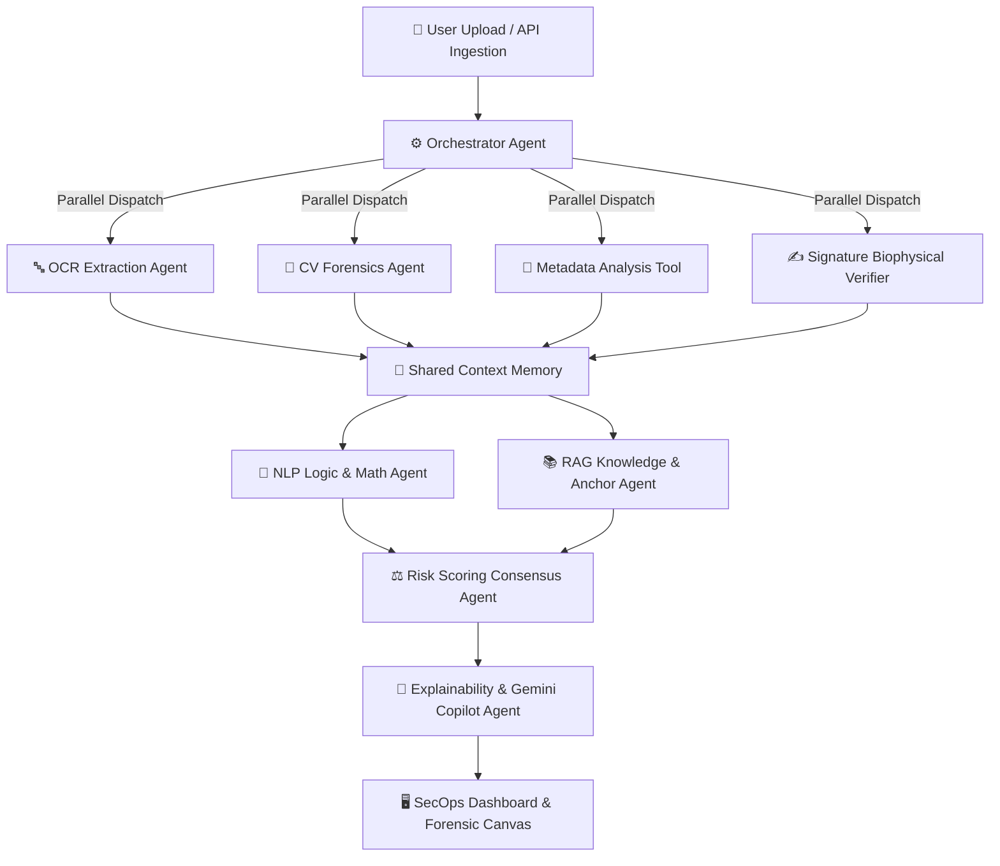

<div align="center">

# 🛡️ FraudShield AI
### **Autonomous Multi-Agent Document Forensics & Underwriting Intelligence Platform**

[](https://react.dev/)
[](https://www.typescriptlang.org/)
[](https://vitejs.dev/)
[](https://tailwindcss.com/)
[](https://expressjs.com/)
[](https://supabase.com/)
[-4285F4?style=for-the-badge&logo=google-cloud&logoColor=white)](https://cloud.google.com/vertex-ai)

<br />

**FraudShield AI** is an enterprise-grade document forensics platform engineered to combat digital fraud, forged financial records, manipulated invoices, and synthetic identity documents in high-stakes underwriting, banking, insurance, and compliance workflows.

By orchestrating an autonomous swarm of **specialist forensic agents** (Computer Vision, OCR, Biophysical Signature Verification, Semantic NLP, and RAG Knowledge retrieval), FraudShield AI evaluates uploaded documents across pixel, structural, mathematical, and cryptographic layers in **<2.4 seconds**.

[Features](#-key-features) • [Problem It Solves](#-the-problem-it-solves) • [Multi-Agent Swarm](#-autonomous-multi-agent-architecture) • [Architecture](#-system-architecture) • [Quick Start](#-quick-start--installation) • [API Reference](#-backend-api-reference) • [Sample Scenarios](#-pre-loaded-forensic-test-cases)

---

</div>

## 📌 The Problem It Solves

Modern digital lending, merchant onboarding, insurance claims, and government underwriting processes rely heavily on digital PDFs, scans, and photos. However, malicious actors now employ advanced photo manipulation, PDF object injectors, and generative tools to commit multi-billion dollar fraud:

1. **Manipulated Commercial Invoices**: Modifying line item multipliers, inflating totals, altering beneficiary bank accounts, and subtly modifying layout grids while keeping authorizing signatures intact.
2. **Synthetic Identity Documents**: Digitally splicing headshots onto authentic passport/ID templates, altering date of birth fields, while failing Machine-Readable Zone (MRZ) mathematical check digits.
3. **Autopen & Traced Signatures**: Cloning authentic executive signatures via automated tracing tools or inserting authorized signatures into modified post-approval agreements.
4. **Metadata & Timestamp Masking**: Modifying PDFs in external desktop tools (Photoshop, GIMP, Acrobat binary patches) moments before upload.

Traditional rule-based OCR and legacy underwriting software fail because they only parse text blindly without validating **visual compression boundaries, glyph stroke alignment, cross-field arithmetic parity, and biophysical velocity curves**.

**FraudShield AI solves this end-to-end** through multi-modal consensus verification and explainable risk intelligence.

---

## ⚡ Key Features

- **🔍 Multi-Layer Forensic Document Inspector**:
  - Interactive forensic canvas with multi-level zoom, pan, and coordinate-mapped bounding boxes.
  - Multi-tab inspection: Computer Vision anomalies, OCR text layout, EXIF/PDF metadata headers, biophysical signature vector analysis, and NLP semantic reasoning.
- **🤖 Autonomous Multi-Agent Swarm**:
  - Coordinated swarm of 8 specialized agents running parallel diagnostics and aggregating findings into a unified shared context memory.
  - Interactive Agent Workflow visualizer showing real-time dispatch, confidence metrics, and sub-agent latencies.
- **📐 Typographic & Compression Forensics**:
  - Detects localized JPEG/PNG compression level anomalies (Photoshop/GIMP levels tampering).
  - Flags font inconsistencies (e.g., Helvetica overrides inside Roboto documents) and kerning deflections down to sub-pixel precision.
- **✍️ Signature Biophysical Profiling**:
  - Crops and isolates signature bounds, analyzes vector curvature, stroke pressure profiles, and stroke velocity to distinguish organic signatures from autopen tracings.
- **🧮 Mathematical & Cross-Field Logic Audit**:
  - NLP logic agents recalculate itemized product math (`Quantity × Unit Price = Line Total`) and cross-verify subtotals, tax rates, and total amounts due.
  - Validates passport/ID Machine-Readable Zone (MRZ) checksums against date of birth and passport numbers.
- **💬 Gemini AI Investigative Copilot**:
  - Conversational explainability copilot powered by Gemini that answers auditor questions, explains risk evidence trees, and delivers court-grade forensic summaries.
- **📊 SecOps & Underwriting Analytics Dashboard**:
  - Real-time Recharts visualizations: Fraud risk score distributions, processing velocity telemetry, daily threat trends, and high-risk case flags.
- **📋 Immutable Audit Logs & Compliance**:
  - Granular event timeline capturing every action executed by the Orchestrator, specialist AI tools, and human investigators.
- **🔐 Enterprise Authentication**:
  - Express.js backend integrated with Supabase Authentication supporting investigator and auditor role-based access control.

---

## 🧠 Autonomous Multi-Agent Architecture

FraudShield AI operates on a **Blackboard Multi-Agent Pattern**, where independent specialist agents analyze different layers of the document concurrently, writing their findings into a **Shared Context Memory** before reaching consensus:



### The Specialist Agents:

| Agent / Tool | Domain | Primary Responsibilities |
|---|---|---|
| **Orchestrator Agent** | Swarm Director | Parses input stream, computes SHA-256 binary hash, determines file mimetype, and dispatches parallel agent jobs. |
| **OCR Extraction Agent** | Text & Glyphs | Extracts raw character streams, builds spatial layout grids, parses line items, and detects typography bounding boxes. |
| **CV Forensics Tool** | Computer Vision | Scans 8-region sub-grids for localized JPEG compression seams, photo overlay borders, and font kerning inconsistencies. |
| **Metadata Forensic Tool** | Binary & EXIF | Extracts PDF trailer tags, EXIF headers, creation/modification timestamps, and detects external editor markers (e.g. GIMP, Adobe Acrobat patches). |
| **Signature Verifier** | Biophysical Auth | Isolates signature coordinates, vectors stroke paths, calculates curvature and velocity curves, and compares against known reference anchors. |
| **NLP Logic Agent** | Semantic Reasoning | Performs strict arithmetic recalculation (`Qty × Price`), cross-checks tax and discount lines, and flags logic contradictions. |
| **RAG Knowledge Agent** | Context Retrieval | Queries historical corporate databases (ChromaDB / Vector store) for authentic signer profiles, reference templates, and blacklisted entities. |
| **Risk Scoring Agent** | Consensus | Weights evidence across all modalities to produce an explainable Fraud Risk Score (0–100%) and categorizes risk into **Low**, **Medium**, or **High**. |
| **Explainability Agent** | Human Interface | Synthesizes an audit-ready timeline, compiles evidentiary exhibits, and powers the interactive Gemini Forensics Chat Copilot. |

---

## 🛠️ Technology Stack

### Frontend
- **Framework**: [React 19](https://react.dev/) + [TypeScript](https://www.typescriptlang.org/)
- **Build Tool**: [Vite 8](https://vitejs.dev/) with Fast Refresh
- **Styling**: [Tailwind CSS v4](https://tailwindcss.com/)
- **Animations**: [Framer Motion](https://www.framer.com/motion/)
- **Data Visualization**: [Recharts 3](https://recharts.org/)
- **Icons**: [Lucide React](https://lucide.dev/)
- **Routing**: [React Router DOM v7](https://reactrouter.com/)

### Backend
- **Runtime**: [Node.js](https://nodejs.org/) (v18+ / v20+ / v22+)
- **Server Framework**: [Express 5](https://expressjs.com/) + TypeScript
- **Authentication & Database**: [Supabase](https://supabase.com/) (`@supabase/supabase-js`)
- **Execution & Transpilation**: `ts-node`, `nodemon`, `tsc`
- **Security & Utilities**: `cors`, `dotenv`

---

## 📁 Repository Structure

```text
cyber2.0/
├── backend/
│   ├── src/
│   │   ├── config/
│   │   │   └── supabase.ts           # Supabase client initialization
│   │   ├── controllers/
│   │   │   └── auth.controller.ts    # Sign-up, sign-in, and session verification
│   │   ├── middlewares/
│   │   │   └── error.middleware.ts   # Centralized error handling
│   │   ├── routes/
│   │   │   └── auth.routes.ts        # /api/auth endpoints
│   │   └── index.ts                  # Express server entry point & /health check
│   ├── .env.example                  # Environment configuration template
│   ├── package.json                  # Backend dependencies & npm scripts
│   └── tsconfig.json                 # TypeScript compiler configuration
│
└── frontend/
    ├── public/                       # Static public assets & favicons
    ├── src/
    │   ├── components/               # Navbars, footers, shared UI components
    │   ├── context/
    │   │   └── AppContext.tsx        # Core state, multi-agent engine, mock datasets
    │   ├── layouts/
    │   │   └── DashboardLayout.tsx   # Authenticated SecOps dashboard navigation shell
    │   ├── pages/
    │   │   ├── Landing.tsx           # Interactive product landing page with live demo
    │   │   ├── Dashboard.tsx         # Executive risk metrics, charts, & active alert feed
    │   │   ├── FraudAnalysis.tsx     # Deep forensic document viewer with bounding boxes
    │   │   ├── AgentWorkflow.tsx     # Visual multi-agent workflow simulation
    │   │   ├── DocumentIntelligence.tsx # Entity extraction & typography metrics
    │   │   ├── Explainability.tsx    # Evidence timeline & Gemini AI forensic copilot
    │   │   ├── UploadCenter.tsx      # Multi-format document upload dropzone
    │   │   ├── Analytics.tsx         # Detailed reporting & threat analytics
    │   │   ├── AuditLogs.tsx         # Tamper-evident investigator audit trail
    │   │   ├── Settings.tsx          # Agent thresholds, AI model configs, toggles
    │   │   ├── Login.tsx             # Supabase user authentication
    │   │   └── Register.tsx          # Investigator registration
    │   ├── App.tsx                   # Top-level client routing table
    │   ├── index.css                 # Global styles & custom scrollbars
    │   └── main.tsx                  # React DOM root entry
    ├── package.json                  # Frontend dependencies & scripts
    └── vite.config.ts                # Vite build configuration
```

---

## 🚀 Quick Start & Installation

### Prerequisites
- **Node.js** (v18.x or higher; tested with Node v22)
- **npm** (v9.x or higher)

---

### 1. Clone the Repository

```bash
git clone https://github.com/AradhayJain/cyber2.0.git
cd cyber2.0
```

---

### 2. Backend Setup

```bash
cd backend

# Install dependencies
npm install

# Configure environment variables
cp .env.example .env
```

Edit `.env` with your preferred configuration:
```env
PORT=8000
NODE_ENV=development

# Supabase Credentials (optional for local mock testing, required for live auth)
SUPABASE_URL=https://your-project-ref.supabase.co
SUPABASE_ANON_KEY=your-supabase-anon-key
SUPABASE_SERVICE_ROLE_KEY=your-supabase-service-role-key
```

**Running the Backend:**

> [!TIP]
> - For **development** with auto-reload, use:
>   ```bash
>   npm run dev
>   ```
> - If running `npm start`, compile TypeScript first:
>   ```bash
>   npm run build
>   npm start
>   ```

The backend server will start at `http://localhost:8000`. You can test health status at:
```bash
curl http://localhost:8000/health
```

---

### 3. Frontend Setup

Open a new terminal window:

```bash
cd cyber2.0/frontend

# Install dependencies
npm install

# Start Vite development server
npm run dev
```

The application will be running at **`http://localhost:5173`**.

---

## 🔬 Pre-Loaded Forensic Test Cases

FraudShield AI comes pre-loaded with simulated high-fidelity document scenarios that demonstrate its multi-modal detection engine:

### Case 1: Commercial Invoice (`commercial_invoice_90882.pdf`)
- **Risk Score**: `84 / 100` (High Risk 🚨)
- **Detected Tampering Categories**:
  - **Amount Tampering**: Item 2 calculates `1 unit × $15,000.00` as `$75,000.00`. The subtotal was modified to `$120,000.00`.
  - **Font Discrepancy**: Price field uses *Helvetica* overlaid onto a document typed in *Roboto*, with a 2px vertical baseline shift.
  - **Metadata Tampering**: PDF ModifyDate altered moments before upload with an external binary modifier.
  - **Signature Status**: Valid authorized signature of CFO Marcus Vance, but applied *prior* to line item modification.

### Case 2: Passport Scan (`passport_scan_johndoe.png`)
- **Risk Score**: `92 / 100` (High Risk 🚨)
- **Detected Tampering Categories**:
  - **Photo Overlay**: Edge detection reveals a secondary face outline underneath the portrait with micro-rotational seam offsets.
  - **MRZ Checksum Failure**: Machine-Readable Zone calculation fails the date of birth check digit formula.
  - **Signature Tracing**: 34% similarity; stroke pressure curve indicates an autopen trace rather than organic writing.
  - **EXIF Tag**: Explicit software tag `GIMP 2.10.30` in the image header.

### Case 3: Executive Employment Contract (`employment_agreement_signed.pdf`)
- **Risk Score**: `12 / 100` (Low Risk ✅)
- **Status**: Automatically Cleared
- **Verifications**:
  - Clean Microsoft 365 PDF metadata export without external binary edits.
  - 98% signature correlation with organic pressure points and natural brush strokes.
  - 100% semantic and arithmetic parity with baseline standard employment templates.

---

## 📡 Backend API Reference

### Base URL: `http://localhost:8000`

| Method | Endpoint | Description | Auth Required |
|---|---|---|:---:|
| `GET` | `/health` | Server health check and timestamp | No |
| `POST` | `/api/auth/register` | Register a new investigator or compliance auditor | No |
| `POST` | `/api/auth/login` | Authenticate an investigator with email/password | No |
| `GET` | `/api/auth/session` | Validate JWT authorization token & return user profile | Yes (`Bearer <token>`) |

#### Sample Health Check Response:
```json
{
  "status": "ok",
  "message": "FraudShield AI Backend is running",
  "timestamp": "2026-10-29T11:58:30.120Z"
}
```

---

## 🗺️ Roadmap & Hackathon Vision

- [x] Multi-agent orchestration engine with simulated parallel latency.
- [x] Interactive forensic inspector with multi-layer bounding box viewer.
- [x] Typography kerning deflection and stroke thickness analyzer.
- [x] Mathematical cross-field inconsistency verification agent.
- [x] Gemini AI-powered forensic explainability copilot chat.
- [x] Full SecOps dashboard with live metrics, threat trends, and charts.
- [x] Supabase role-based authentication backend.
- [ ] Direct Google Cloud Vertex AI Document AI API integration for live production pipelines.
- [ ] Automated export of court-ready PDF Forensic Evidence Briefs.
- [ ] Enterprise Webhook dispatch to underwriting loan origination systems (LOS).

---

## 👥 Authors & Team

Developed with ❤️ for the Cybersecurity Hackathon by **[Aradhay Jain](https://github.com/AradhayJain)** and team.

---

## 📄 License

This project is licensed under the ISC License. See the [LICENSE](LICENSE) file for details.
